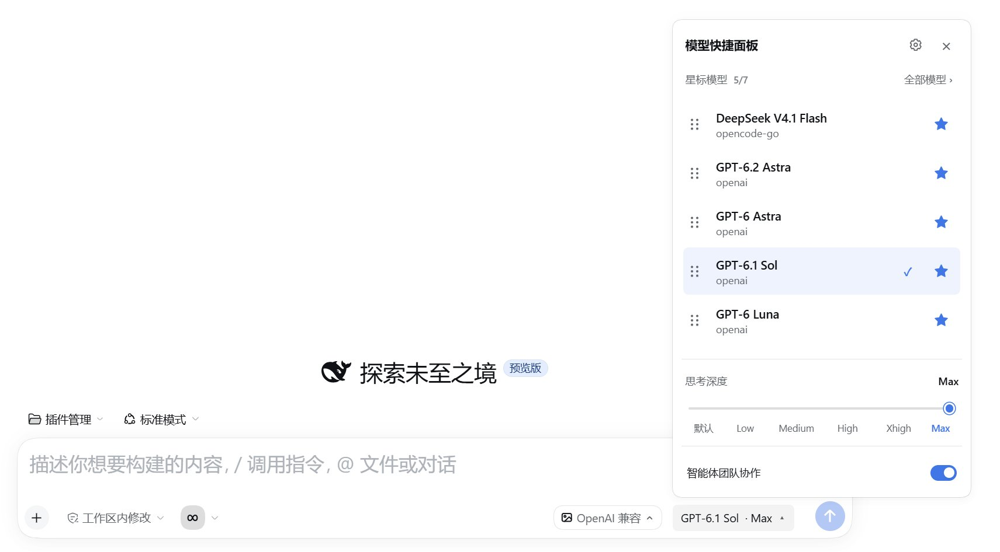
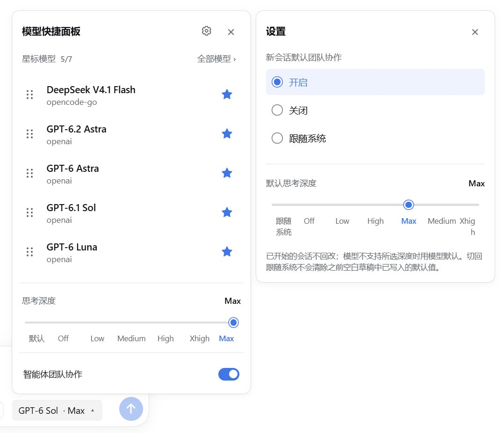
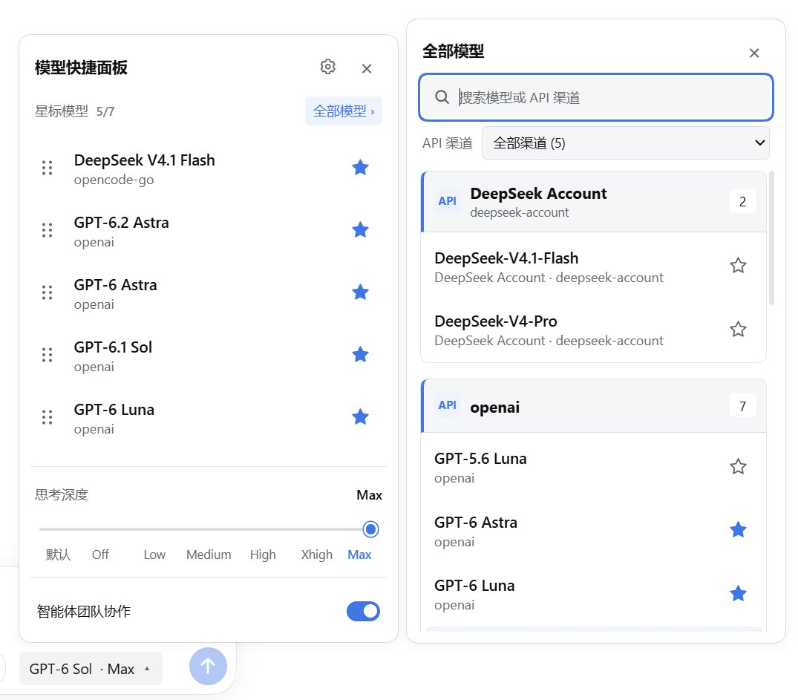

# DSH 模型快捷面板

**常用模型一眼找到，切模型、调深度、开关团队一处完成；还能固定后续新会话的智能体团队设定和默认思考深度——不用反复打开菜单、来回跳转，也少了滚动翻找。**

把常用模型留在手边，需要换其他模型时再展开右侧列表。主面板直接管理当前会话；1.3.0 新增齿轮入口，在独立的右侧设置面板预设以后新会话的智能体团队和思考深度，主面板不会随设置展开、收起。

[下载 GitHub 仓库当前版本 ZIP](https://github.com/leonchan2840/dsh-quick-model-panel/archive/refs/heads/main.zip) · [安装方法](#安装) · [问题反馈](https://github.com/leonchan2840/dsh-quick-model-panel/issues) · [MIT 开源](./LICENSE)



*新版真实界面截图，原图未裁切。可选模型、API 渠道和思考档位取决于你的 DSH 配置；插件不提供模型服务。*

如果你觉得插件好用，欢迎到我的 [GitHub](https://github.com/leonchan2840/dsh-quick-model-panel) 给项目点个 Star。你的支持会让更多 DSH 用户发现它；有改进建议也欢迎提 [Issue](https://github.com/leonchan2840/dsh-quick-model-panel/issues)。

## 少找几次，少点几步

| 你想做的事 | 在快捷面板里怎么做 |
| --- | --- |
| **常用模型直接选** | 最多收藏 7 个模型，打开就能点，不用每次翻完整列表。 |
| **当前会话一次设完** | 切模型、调思考深度、开关智能体团队后，主面板保持打开，可以接着操作。 |
| **新会话默认值** | 1.3.0 中点击齿轮，在独立右侧面板把后续新会话的团队固定为「开启」或「关闭」，也可选「跟随系统」；默认思考深度复用滑块，已有对话不被覆盖。 |
| **其他模型更好找** | 「全部模型」在右侧按 API 渠道分组，还能筛选渠道、搜索模型，减少滚动翻找。 |
| **顺序自己排** | 拖动模型左侧的点阵手柄，把最常用的放到最顺手的位置。 |

### 齿轮设置：固定新会话的默认配置



主面板仍控制**当前会话**；齿轮打开的独立面板控制**后续新会话**。团队可以固定开启或关闭，也可以跟随 DSH 系统配置；默认思考深度可以选择一个档位或跟随系统。手动改过相应选项的空白草稿和已经开始的对话不会被覆盖。上图为用户提供的完整截图，未裁切。

### 全部模型：按 API 渠道查找



右侧列表与主面板并排，点星星收藏不必反复打开；点模型名称切换后，主面板可以继续调节当前会话的深度和团队。上图为用户提供的完整截图，未裁切。

## 安装

**适配版本：DSH Desktop `0.2.2-rc.3`。其他版本尚未验证。** 请先在 DSH 中配置好你要使用的模型渠道。

1. 安装 **GitHub 上的当前源码版本**：点击 **[下载仓库 ZIP](https://github.com/leonchan2840/dsh-quick-model-panel/archive/refs/heads/main.zip)**，或在仓库首页选择 **Code → Download ZIP**。这个 ZIP 始终跟随 `main` 分支；上传 1.3.0 源码后，它就不再是旧版 1.2.1。若要安装旧版，请下载旧版 GitHub Release/标签对应的 ZIP，或使用下方固定版本的 npm 命令。
2. 解压到准备长期存放插件的位置。仓库已包含可运行的构建产物，**无需自行编译**。
3. 在 DSH 的 **「插件」** 页面选择 **添加本地目录**，选中解压后含有 [package.json](./package.json) 的那一层目录，安装并启用。
4. 刷新 DSH 页面，点击输入框原来的**模型按钮**，即可打开快捷面板。

> 安装后不要移动或删除该目录：DSH 通过本地目录链接使用插件。想恢复原版入口，在插件管理中停用「模型快捷面板」即可。

### 从 npm 安装（当前公开版本 1.2.1）

包名为 `@leonchan2840/dsh-quick-model-panel`。已配置 DSH 命令行的用户可运行下面的命令；请把 `desktop` 换成实际使用的 profile 名称：

```sh
dsh plugin --profile desktop add @leonchan2840/dsh-quick-model-panel@1.2.1
```

上述命令安装的是 npm 上固定的 **1.2.1**，**不包含本文新增的新会话默认设置**；这些设置属于 GitHub 1.3.0 版源码，npm 发布 1.3.0 前不要把两个渠道的版本混淆。npm 包自带构建产物，无需额外编译。若已经安装旧的本地版，请先停用旧版，再启用 npm 版，避免两个面板争用同一个入口；无需删除旧目录。收藏使用同一份浏览器本地存储，不因包名变化而主动清除。

## 第一次怎么用

1. **打开面板**：点击输入框下方的模型按钮，首次打开会自动收藏当前模型一次。
2. **把常用的留下来**：点「全部模型」，找到需要的模型后点右侧星星。可以连续收藏，不会每点一次就关闭列表。
3. **连续完成设置**：点模型名切换，再拖动思考深度滑块，按需开关当前会话的团队协作。1.3.0 新增的**新会话默认值**从标题栏齿轮打开，在右侧独立面板设置；完成后点面板外部或按 `Esc` 退出。

日常只用主面板即可。浅色底和勾表示当前模型，实心星表示已收藏；入口同步显示「模型名 · 当前思考深度」。需要改变**以后新会话**的默认值时，再打开齿轮设置，不影响这里正在使用的会话。

## 使用前知道这些就够了

- **点名称切换，点星星收藏**：取消星标只会移出常用列表，不会切走正在使用的模型。收藏满 7 个后，再收藏时由你选择替换哪一个，不会自动挤掉旧模型。
- **切模型遵循 DSH 原生规则**：不继承旧模型的深度，默认使用目标模型自己的默认档；若你在面板「设置」里明确选择了跨模型默认深度，并且目标模型支持该档，才应用这一偏好。不支持调节的模型不显示滑块。
- **新会话默认值可选（1.3.0）**：点标题栏齿轮，在独立右侧面板用单选项选团队「开启／关闭／跟随系统」，用滑块选默认思考深度（或跟随系统）。目标模型不支持所选档位时使用目标模型默认档。已发过消息的会话、手动改过相应选项的空白草稿以及子智能体不被覆盖；DSH 可能复用尚未发消息的空白草稿，设置保存时会补到符合条件的草稿。若空白草稿曾被插件写入明确默认值，切回「跟随系统」无法清除它已有的显式历史选择；该草稿用过后新建的全新会话才会跟随系统。
- **当前会话的控制保持独立**：滑块和团队开关更改当前会话；模型选择与 DSH 原生一致，会同时尝试更新后续新会话的全局默认模型。已使用过模型的会话关闭团队前会再次确认。
- **收藏留在本机**：同一浏览器或桌面 Web 客户端内跨会话保留，不跨设备同步。不要在多个窗口同时修改收藏，避免后写覆盖先写。详见 [安全与隐私说明](./SECURITY.md)。

## 常见问题

<details>
<summary><strong>会修改 DSH 本体，或影响原来的命令吗？</strong></summary>

不会修改 DSH 安装文件，也不改变 `/model` 命令。停用插件可恢复原生模型入口，但不会撤销已经保存的会话设置或删除收藏。

占用同一模型按钮、或给原生模型菜单添加专属条目的其他 UI 插件，不会同时显示在这个自定义面板中。

</details>

<details>
<summary><strong>收藏、拖动排序和关闭面板有哪些细节？</strong></summary>

- 首次自动收藏当前模型只发生一次，手动取消后不会自动补回。不可用的已收藏模型可手动取消，不会被自动替换。
- 拖动左侧手柄时显示插入位置，松手保存；拖到面板外或按 `Esc` 取消。也可聚焦手柄后用上下方向键、`Home` / `End` 排序。排序不切换模型，也不改变收藏状态。
- 在右侧选模型成功，只收起右侧列表，主面板仍然打开。窄窗口无法并排时可返回主层。
- 主面板随内容自然展开。窗口太小时优先滚动收藏区，保留深度和团队入口；极短窗口支持整层滚动。

</details>

<details>
<summary><strong>思考深度什么时候生效？“默认”是什么意思？</strong></summary>

滑动时预览，松手或松开方向键时提交。入口摘要只跟随已生效的设置，不把拖动预览或失败的提交当成结果。

未声明默认档的模型显示「默认」，提交时省略档位参数，由提供方决定；不会擅自使用第一档。当前保存的历史档位若已不在目录中，入口显示原档位 ID，不把它冒充为默认档。较长的入口文字可悬停查看完整信息。

</details>

<details>
<summary><strong>为什么首次开源的版本是 1.2.1？</strong></summary>

版本号沿用本地开发时的迭代编号，不表示此前已有公开版本。后续发布版本时，对应固定的代码提交，再按改动递增版本号。

</details>

## 开发与贡献

发现使用问题可通过 [Issues](https://github.com/leonchan2840/dsh-quick-model-panel/issues) 反馈，请附 DSH 版本、复现步骤和去除私人信息的截图。安全问题请遵循 [安全说明](./SECURITY.md)，不要在公开反馈中贴密钥或令牌。

<details>
<summary><strong>构建、测试与代码导航</strong></summary>

在本项目目录运行：

```sh
node build.cjs
node --test
```

构建脚本使用 Node 内置模块；Host 依赖固定版本的 `@deepseek-ai/schemastery`，npm 安装时按依赖声明获取；无额外安装脚本，客户端复用 DSH 的 React。测试覆盖业务规则、存储失败与交错读写、布局及默认值生命周期，不代替真实桌面的端到端验收。

| 文件 | 职责 |
| --- | --- |
| [logic.cjs](./src/logic.cjs) | 目录归一化、档位解析、收藏存储和排序 |
| [host-view.cjs](./src/host-view.cjs) | DSH 会话接线、设置侧栏、写入守卫、团队确认与共享收藏状态 |
| [startup-defaults.cjs](./src/startup-defaults.cjs) | 新建与复用空白草稿时应用默认值、保护手动修改并处理保存竞态 |
| [view.cjs](./src/view.cjs) / [panel.css](./src/panel.css) | 主面板、两个独立右侧面板、拖动、焦点与视觉样式 |
| [build.cjs](./build.cjs) | 生成随仓库提供的 [client.js](./client.js) |
| [test](./test/) | 业务规则、集成接线与回归检查 |
| [截图资源](./docs/images/) | 用户提供的三张新版真实界面截图，完整保留、未裁切或重绘 |

源码仓库保留 [client.js](./client.js)，方便下载后直接安装。修改源码后请重新构建，并一起提交对应产物。

源码仓库中的忽略规则用于排除浏览器调试记录、日志、缓存和常见凭据文件；GitHub 网页上传不会自动执行这些规则，仍需手动排除。npm 发行包使用 [package.json](./package.json) 的 `files` 白名单，包含预构建入口、源码、测试和截图，不包含本地配置与调试记录。包名、组合包引用和客户端模块 ID 必须保持一致；修改包名后请重新构建。

本文对应 **已上传 GitHub 的 1.3.0 源码版**；npm 安装命令目前仍指向已公开的 1.2.1。后续发布 npm 1.3.0 前，应重新运行构建与测试、检查 `npm pack --dry-run --ignore-scripts` 和真实安装效果，并由作者确认。

</details>

<details>
<summary><strong>开发迭代记录与设计参考</strong></summary>

- **1.3.0（GitHub 源码版；npm 尚未发布）**：增加齿轮右侧设置面板与后续新会话团队/深度默认值；修复复用空白草稿、手动改动保护与保存竞态。切换模型使用目标模型默认深度，不继承旧档。
- **1.2.1**：主面板改为自然高度；入口显示当前模型与思考深度；修复旧请求误关新搜索层与历史档位显示边界；合并重复逻辑，补充安全检查和 MIT 许可。
- **1.2**：按 API 渠道分组与筛选；收藏上限增至 7 个；支持拖动与键盘排序，保留原有收藏与顺序。
- **1.1**：独立的模型选择与星标点击区域；连续收藏保留搜索词与列表；远端设置请求不锁住本地收藏。
- **1.0**：将模型、思考深度与团队开关集中到同一个快捷面板。

列表参考 [Raycast List](https://developers.raycast.com/api-reference/user-interface/list) 的主次文字与行尾操作；控件参考 [Radix Popover](https://www.radix-ui.com/themes/docs/components/popover) 和 [Switch](https://www.radix-ui.com/themes/docs/components/switch)。使用 DSH 自身的主题颜色、字体与阴影，不加载外部 UI 库。

</details>

## 开源许可

按 [MIT License](./LICENSE) 开源，允许使用、修改、分发和商业使用，须保留版权及许可声明。

这是独立的社区插件，不是 DSH 官方组件。DSH 与宿主 React / ReactDOM 不随本包分发，各自遵循原项目许可。
